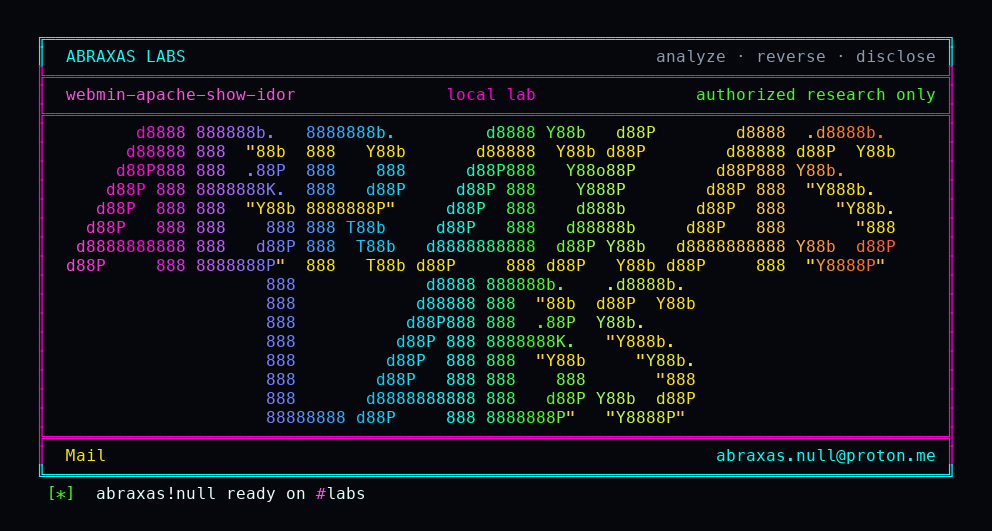

<p align="center">
  
</p>

# webmin-apache-show-idor

You give someone the Apache module in Webmin and only their website. The other virtual hosts are supposed to stay off their list. They still open one URL with the other site's name and read every directive for it: document roots, SSL certificate paths, rewrite rules, proxy backends, SetEnv values. They cannot change that host. They cannot open it in the list. The dump page forgot the check.

**Class:** IDOR
**Reach:** Remote (Apache module user denied that virtual host)

I sat on `apache/show.cgi` because `virt_index.cgi` already refused the same id. The printer never called `can_edit_virt`. Loopback lab on 2.670 printed `WEBMIN-H01-APACHE-IDOR` out of the denied vhost and kept the siblings closed.

**Webmin** `2.670` (`3a2b2b86`) - Webmin

| | |
|---|---|
| ID | no CVE yet |
| Class | **IDOR** |
| Reach | **Remote** (signed-in Apache module user; `virts` ACL denies that host) |
| CWE | [CWE-639](https://cwe.mitre.org/data/definitions/639.html) |
| CVSS | **Medium: 6.5** `CVSS:3.1/AV:N/AC:L/PR:L/UI:N/S:U/C:H/I:N/A:N` |
| Product | [Webmin](https://github.com/webmin/webmin) |
| Affected | **2.670** (`3a2b2b8671c0669c129f5275b3dd1853106ae02b`) |
| Auth | signed-in Webmin user granted the apache module, denied that VirtualHost |
| License | [GNU Affero GPL v3.0](LICENSE) |
| Lab | `127.0.0.1:18490` only |

This is not unauthenticated. This is not a write. Granting the Apache module is not supposed to mean every vhost. `virts` is the per-host allow list. The list already uses it.

## What an attacker can do

Needs a Webmin login that already has the Apache module, with `virts` set to their own host. They need the other site's `ServerName:port` (or its config index). They do not need `types=*`. They do not get a shell.

| Privilege | Method / sink | Recon / integrity / availability | Lab-proven or inferred |
|---|---|---|---|
| Dump denied vhost directive names and values | GET `/apache/show.cgi?virt=denied.example:80` | Recon (config) | Lab-proven. Witness `WEBMIN-H01-APACHE-IDOR` in the `<pre>` body. Deny string absent |
| Same dump by config index | GET `/apache/show.cgi?virt=<idx>` | Recon | Source. `get_virtual_config` accepts a decimal index (`apache-lib.pl:542`) |
| Dump a Directory section under a swapped virt | GET `/apache/show_dir.cgi` | Recon | Source. `show_dir.cgi:7` never calls `can_edit_virt` |
| Own vhost still works | GET `/apache/show.cgi?virt=allowed.example:80` | n/a | Lab-proven. Own `ServerAdmin`, no witness |
| Negative: list page on the denied id | GET `/apache/virt_index.cgi?virt=denied.example:80` | n/a | Lab-proven. `You cannot edit this virtual server`. No witness |
| Negative: save on the denied id | GET `/apache/save_virt.cgi?virt=denied.example:80` | n/a | Lab-proven. Same deny string. No witness |

**Stays closed on this leftover**

| Axis | Method / sink | Why it is closed |
|---|---|---|
| Recon | `virt_index.cgi`, `show_virt.cgi`, `dir_index.cgi` | `can_edit_virt` at line 8 |
| Integrity | `edit_virt.cgi`, `save_virt.cgi`, `edit_dir.cgi`, `save_dir.cgi` | same helper |
| Integrity | `manual_save.cgi` splice of the block | `types` must be `*`. Lab user is `types=0 1 2 3 4 5` |
| Recon | File Manager prefix listing | fixed in 2.670. Not this path |
| Integrity | unauthenticated write, host RCE | out of class |

The leak is the file bodies of the vhost config directives (names and values). It is not the bytes of `SSLCertificateKeyFile` unless that key is inline in the config.

## How I found it

I pinned webmin/webmin **2.670**. The policy at [webmin.com/security](https://webmin.com/security/) says fine-grained ACLs are the control once a module is granted. `get_virtual_list_rows` already greps through `can_edit_virt`. `virt_index.cgi:8` and `save_virt.cgi:8` error the same id. `show.cgi` loads `virt` at line 19 and prints at line 68. Nothing on that path calls the helper.

Wrong turns: treating Apache-module-granted as out of policy (the `virts` ACL is the control); filing `show_virt.cgi` (it checks); walking the UI from the list (denied hosts are not linked; the query string is enough); treating `manual_save.cgi` as the write (needs `types=*`); refiling File Manager listing.

## Lab

Docker, git, python3.

```bash
python3 webmin-apache-show-idor-Abraxas-Labs.py
```

or:

```bash
cd lab
./run.sh
```

Clones [webmin/webmin](https://github.com/webmin/webmin) tag **2.670** (`3a2b2b8671c0669c129f5275b3dd1853106ae02b`) into `lab/src`, builds `webmin-lab:2.670`, plants two vhosts and a `virts`-limited user, then hits loopback `http://127.0.0.1:18490`. The launcher `chdir`s into `lab/` and execs `run.sh`.

```text
IOC image=webmin-lab:2.670 label-version=2.670
IOC webmin-version=2.670
IOC plant witness=1 allowed-only=1 acl-virts=1
IOC login=limited sid=1
IOC allowed-show status=200 witness=0 own=1
IOC denied-virt-index status=200 denied=1 witness=0
IOC denied-save-virt status=200 denied=1 witness=0
IOC denied-show status=200 witness=1 denied-text=0
SUCCESS WEBMIN-H01-APACHE-SHOW WEBMIN-H01-APACHE-IDOR
```

## The fix

Call `can_edit_virt` on `show.cgi` after `get_virtual_config`, the same two lines `virt_index.cgi` already has. Do the same on `show_dir.cgi`.

```perl
($conf, $v) = &get_virtual_config($in{'virt'});
&can_edit_virt($v) || &error($text{'virt_ecannot'});
```

Until then, do not treat "I hid the vhost from the list" as "I hid the directives."

## References

- [github.com/webmin/webmin](https://github.com/webmin/webmin) tag [2.670](https://github.com/webmin/webmin/releases/tag/2.670) (`3a2b2b8671c0669c129f5275b3dd1853106ae02b`)
- [`apache/show.cgi`](https://github.com/webmin/webmin/blob/2.670/apache/show.cgi) (`show.cgi:19`, `:68`, `:120`)
- [`can_edit_virt`](https://github.com/webmin/webmin/blob/2.670/apache/apache-lib.pl) (`apache-lib.pl:1882`) · [`get_virtual_config`](https://github.com/webmin/webmin/blob/2.670/apache/apache-lib.pl) (`apache-lib.pl:542`)
- Siblings that refuse: [`virt_index.cgi`](https://github.com/webmin/webmin/blob/2.670/apache/virt_index.cgi) · [`show_virt.cgi`](https://github.com/webmin/webmin/blob/2.670/apache/show_virt.cgi) · [`edit_virt.cgi`](https://github.com/webmin/webmin/blob/2.670/apache/edit_virt.cgi) · [`save_virt.cgi`](https://github.com/webmin/webmin/blob/2.670/apache/save_virt.cgi)
- [CWE-639](https://cwe.mitre.org/data/definitions/639.html)

## License

GNU Affero GPL v3.0. See [LICENSE](LICENSE). Loopback lab only. No warranty.

Abraxas Labs
abraxas.null@proton.me
